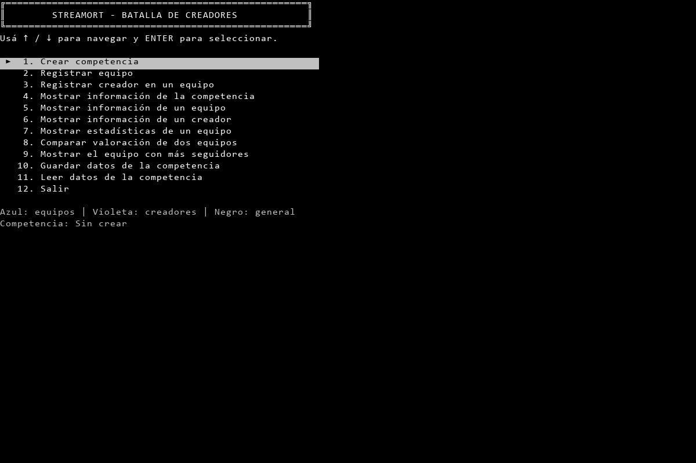
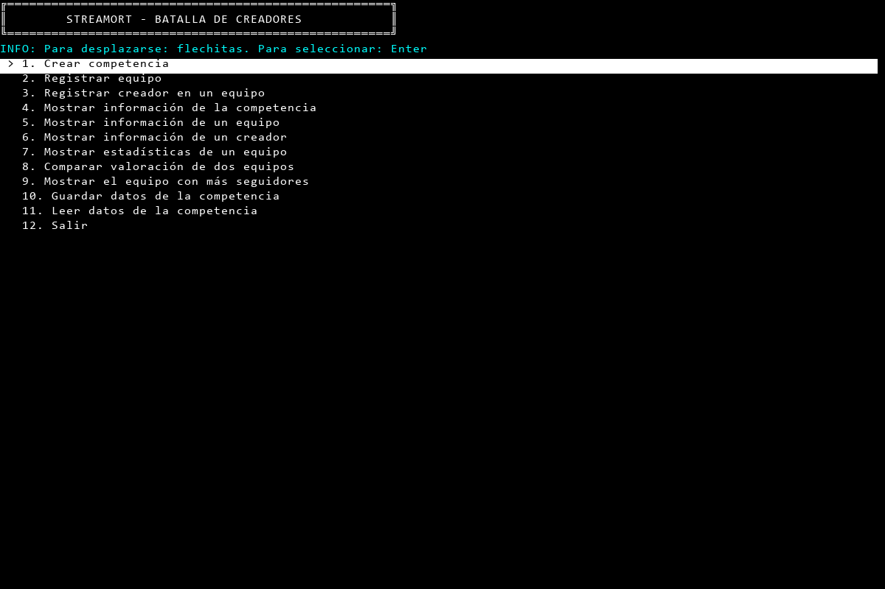
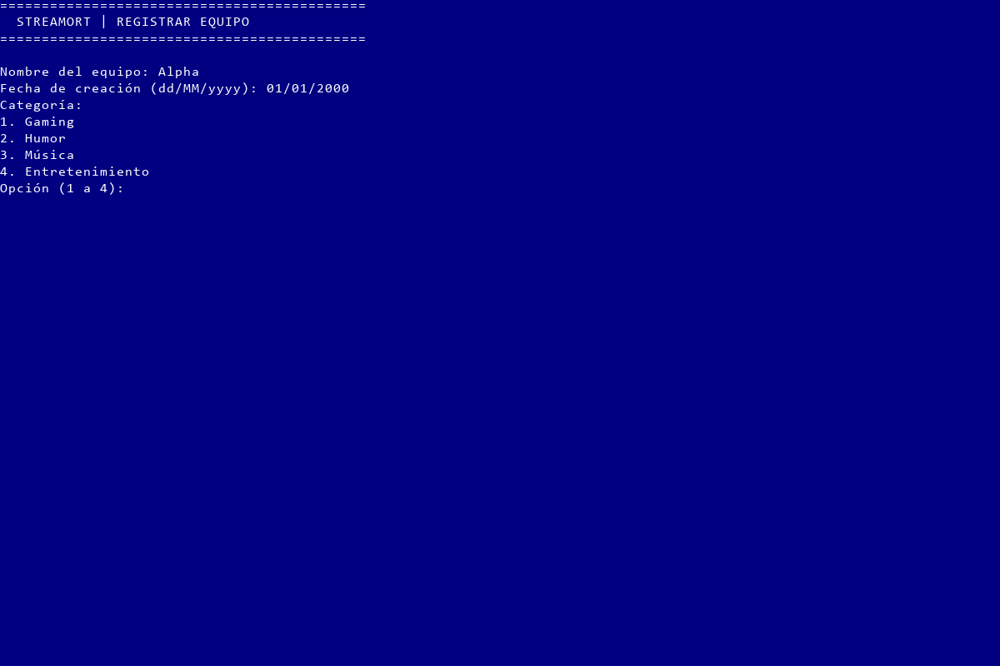
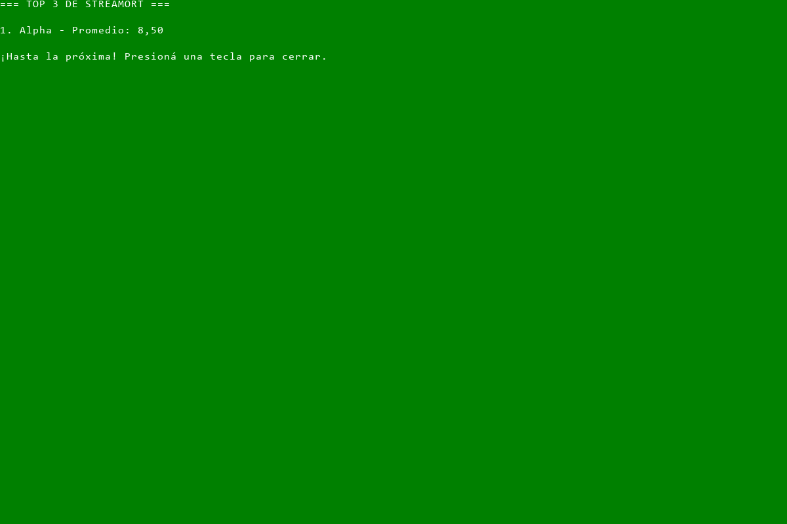

# Comparación visual y de navegación de StreamORT

Fecha: 03/11/2026. Etapa 3.5, tarea de contraste anterior a declarar `ColoresMenu`. Se ejecutaron el original y las utilidades públicas actuales; no se descompiló ni se modificó su código.

## Evidencia y alcance

Se capturaron 43 pantallas: 34 del original (incluidas dos de tamaños alternativos), seis de la aplicación actual y tres de una sonda que llama las utilidades reales. La evidencia está en [Interfaz-20261103](../../test/resultados/Interfaz-20261103): PNG para inspección, TXT con posiciones de líneas y JSON con entradas, segmentos de texto, colores y estado del cursor. [resumen.json](../../test/resultados/Interfaz-20261103/resumen.json) contiene comprobaciones de circularidad, selección, ancho y fondos. No son 43 pruebas unitarias.

Las imágenes son reconstrucciones de las celdas ANSI capturadas mediante ConPTY/pywinpty y procesadas con pyte. Utilizan Consolas de 16 px, celdas de 10 × 20 px y paleta ANSI clásica; no son fotografías de una ventana de Windows ni fijan su tipografía o paleta personalizadas. Los colores lógicos y las posiciones de celdas están conservados en JSON. Las transcripciones anteriores, que eliminaban ANSI y espacios, no bastaban para este contraste.

Original: runtime .NET 8.0.33 local; programa y datos copiados a `IA/Verificacion/ComparacionInterfaz/Original` y `OriginalExtra`. Se comprobó SHA-256 de todos los archivos de `Ejecutable/` antes y después de las sesiones: sin cambios; [integridad.json](../../test/resultados/Interfaz-20261103/integridad.json). El escenario crea Visual / Sponsor / 2027 / cuatro cupos, equipo Alpha y creadora Ana, alias ana, 20 años, 500 mil seguidores, valoración 8,5, Streamer, usando únicamente el menú del original. Guardado y cancelaciones actúan sobre la copia aislada.

Aplicación actual: compilada desde el repositorio con SDK 10.0.401, destino net8.0 y ejecutada sobre el mismo runtime .NET 8. Bibliotecas en `a78e2c55e5e469e22874aab9d3bd7f87e285141b`. No se probaron funcionalidades de los casos vacíos como si estuvieran implementadas: las fichas actuales se contrastan con las capacidades de `MostrarTabla` mediante una sonda separada.

Dimensiones principales: 120 columnas × 40 filas; menú original también observado a 80 × 24 y 160 × 40. No se afirma comportamiento para todo tamaño, redimensionamiento durante la sesión, terminal, texto arbitrariamente largo o caracteres Unicode de doble ancho.

## Menú principal

| Aspecto | Original comprobado | Utilidad o aplicación actual | Adaptación necesaria |
| --- | --- | --- | --- |
| Título | Marco doble `╔═╗`, título y pie en las primeras tres filas. | El texto de `Program` ya coincide en esta muestra. `ImprimirTextoConMarco` añade sus propios márgenes y adapta el ancho. | Conservar el título literal de `Program`; no reemplazarlo por un marco que cambie sus espacios. |
| Ayuda | Fila 4: `Usá ↑ / ↓ para navegar y ENTER para seleccionar.`; después una fila vacía. | `INFO: Para desplazarse: flechitas. Para seleccionar: Enter`, en cian y sin la separación original. | Permitir texto de ayuda literal y controlar su color y separación. |
| Opciones | Filas 6–17. Números alineados a dos caracteres; marcador `►` en la segunda columna, con margen inicial. | Marcador `>`; prefijo fijo de tres caracteres; números sin alinear en `Program`. Empiezan una fila antes. | Configurar formato de línea, marcador y espacios; evitar duplicar la numeración. |
| Resaltado | Negro sobre gris (`ConsoleColor.Black` / `ConsoleColor.Gray`), 55 celdas desde columna 1, en los tres anchos ensayados. | Negro sobre blanco brillante (`White`) en 119 celdas a ancho 120. | Colores agrupados en `ColoresMenu`; ancho de resaltado independiente del ancho de ventana. |
| Texto y pie | Texto blanco brillante en título/opciones. Tras fila vacía, leyenda `Azul: equipos \| Violeta: creadores \| Negro: general` y `Competencia: Sin crear` o el nombre; pie en color predeterminado. | No se muestran leyenda ni competencia activa. | Dejar que `Program` proporcione el contexto; la biblioteca no debe conocer `Competencia` o `Datos`. |
| Flechas | Arriba desde primera lleva a opción 12; abajo desde 12 lleva a primera. | `EjecutarMenu` se detiene en los extremos. | Navegación circular. |
| Vuelta al menú | Conserva opción seleccionada y elimina la pantalla anterior. | Cada llamada inicializa `index = 0`. El camino sin competencia hace `continue` sin limpiar historial y aparecen menú anterior, mensaje y menú nuevo juntos. | Recibir selección inicial y conservarla en `Program`; limpiar pantalla e historial al cambiar de operación, sin perder lo que deba mantenerse dentro del mismo formulario. |
| Otras teclas | Número 5 y Escape no cambian la selección ni eligen opción. Home, End, PageUp y PageDown no cambiaron la quinta opción en el ensayo adicional. | Home/End/PageUp/PageDown mueven la selección. | El comportamiento de compatibilidad con StreamORT debe respetar las teclas observadas. |

En esta tabla las filas y columnas se cuentan desde 1. Los JSON usan índices desde 0.

Capturas comparables del inicio:





Evidencia de navegación: [arriba desde primera](../../test/resultados/Interfaz-20261103/original-02-arriba-desde-primera.txt), [abajo desde última](../../test/resultados/Interfaz-20261103/original-03-abajo-desde-ultima.txt), [selección conservada](../../test/resultados/Interfaz-20261103/original-09-menu-conserva-seleccion.txt), [historial acumulado actual](../../test/resultados/Interfaz-20261103/actual-04-menu-tras-volver.png). Los ensayos de Home/End/PageUp/PageDown están en [original-extra.json](../../test/resultados/Interfaz-20261103/original-extra.json).

## Colores de las operaciones

El fondo se establece antes de limpiar; llena también el espacio sin texto. Las pantallas de operación ensayadas tienen texto blanco brillante (`White`).

| Pantalla | Fondo observado | Equivalente ConsoleColor |
| --- | --- | --- |
| Menú, crear competencia, mostrar competencia, guardar, leer y confirmaciones | Negro/predeterminado negro en estas sesiones | `Black` |
| Registrar equipo, mostrar equipo, estadísticas, comparar y equipo con más seguidores | Azul oscuro | `DarkBlue` |
| Registrar y mostrar creador | Magenta oscuro/violeta | `DarkMagenta` |
| TOP 3 con candidatos y sin datos | Verde oscuro | `DarkGreen` |

El error de ausencia de competencia de las opciones 5 y 8 se muestra ya con fondo azul: el color depende de la operación antes de validar datos. Al volver al menú se restaura negro. La frase de la leyenda del menú no menciona el verde de la salida; se conserva su texto literal.

El cursor figura visible en las celdas capturadas; no introducir ocultamiento como requisito supuesto del original. Las capturas PNG no dibujan el parpadeo o la forma del cursor. La restauración lógica del cursor y colores debe verificarse al implementar.





## Selecciones dentro de formularios

El menú principal usa flechas y Enter, pero categoría y especialidad muestran una lista numerada y solicitan una línea `Opción (1 a 4):`. En el escenario se aceptaron `1` y Enter; sus cuatro nombres están en las [categorías](../../test/resultados/Interfaz-20261103/original-08-categorias.txt) y [especialidades](../../test/resultados/Interfaz-20261103/original-10-especialidades.txt). Se muestra `Música`, con tilde.

`PedirEnum` actual convierte los nombres del enum en opciones y llama al menú de flechas. La [sonda de categoría](../../test/resultados/Interfaz-20261103/utilidades-categoria-01.png) confirma que usa sus valores predeterminados verdes sobre negro, añade la ayuda INFO y muestra `Musica` sin tilde. No mantiene por defecto el azul que tenía el llamador.

Para interfaz idéntica, la biblioteca debe admitir selección numérica con ese texto de solicitud y etiquetas de presentación, además del menú de flechas. Se mantiene el requisito de utilizar `PedirOpcionMenu`; su adaptación deberá contemplar estos dos modos o delegar el modo numérico en una utilidad apropiada. `ColoresMenu` agrupa colores; el modo de entrada no debe disfrazarse como un campo de color. Los campos y la firma definitiva se diseñarán en la siguiente tarea, sin agregar ahora una API no acordada.

Las confirmaciones son una tecla tras `(S/N):`, no una lista navegable. Sus textos literales son:

```text
¿Reemplazar la competencia actual y sus datos? (S/N):
¿Reemplazar los datos en memoria por los archivos? (S/N):
```

No utilizar directamente `PedirBool`: espera `y/n` y repregunta; el original confirma `s/S` y cancela las otras teclas ensayadas. Estas reglas funcionales ya están documentadas en el análisis previo.

## Encabezados, fichas, mensajes y tablas

Las operaciones usan dos líneas de exactamente 44 signos `=`, con `  STREAMORT | <OPERACIÓN>` entre ellas y una fila vacía después. El separador no crece con el título: algunas leyendas exceden las 44 columnas. `ImprimirSeparador` actual produce el ancho de ventana menos uno y usa `═` por defecto; `ImprimirTextoConMarco` dibuja marco doble con relleno. Ninguno puede sustituir esos encabezados sin admitir formato explícito.

El original muestra fichas en texto plano. La competencia comienza así:

```text
Visual | Sponsor: Sponsor | Año: 2027 | Cupos: 1/4
Equipo: Alpha | Creación: 01/01/2000 | Categoría: Gaming
Creadores (1):
  - Ana (@ana) | Edad: 20 | Seguidores: 500 mil | Valoración: 8,5 | Especialidad: Streamer | Estrella: Sí
```

La ficha individual no añade el prefijo `  - `. Las estadísticas usan líneas `Equipo:`, `Valoración promedio: 8,50`, `Cantidad de streamers:`, `Total seguidores:` y `Creador más popular:`. Las valoraciones de ficha conservan `8,5`; el promedio y el TOP 3 presentan dos decimales con coma. Ver [ficha de equipo](../../test/resultados/Interfaz-20261103/original-12-equipo.txt), [creador](../../test/resultados/Interfaz-20261103/original-13-creador.txt) y [estadísticas](../../test/resultados/Interfaz-20261103/original-14-estadisticas.txt). El texto largo del creador más popular envuelve naturalmente en la terminal de 120 columnas; la captura no permite deducir un salto de línea programado en esa posición.

`MostrarTabla(string[,])` actual siempre añade bordes `+`, `-` y `|`, márgenes y una separación por fila, con columnas calculadas según ventana. Ver [sonda real](../../test/resultados/Interfaz-20261103/utilidades-tabla-01.png). Para usarla sin alterar el original deberá admitir presentación sin bordes ni espacios añadidos; `Program` podrá construir las líneas exactas como una columna. La biblioteca no debe formar textos específicos del dominio.

Los mensajes del original no llevan `ERROR:`, `EXITO:` o `INFO:`. Por ejemplo, el año fuera de rango imprime `Ingresá un número entero válido.` en blanco y repite la solicitud. El éxito imprime `Competencia creada.` en blanco. Las utilidades actuales agregan etiquetas y cambian color; la [sonda de mensajes](../../test/resultados/Interfaz-20261103/utilidades-mensajes-01.png) muestra el comportamiento real. La presentación compatible deberá permitir texto literal, sin etiquetas automáticas y con los colores del formulario, manteniendo los mensajes genéricos para los otros consumidores si corresponde.

Las pantallas normales terminan con una fila vacía y `Presioná cualquier tecla para volver al menú...`. La salida es una pantalla propia verde con `=== TOP 3 DE STREAMORT ===`, una fila por equipo (`1. Alpha - Promedio: 8,50`) y `¡Hasta la próxima! Presioná una tecla para cerrar.`. Sin candidatos dice `No hay equipos con creadores para armar el ranking.`. No utilizar la pausa de vuelta al menú para el cierre.

## Cambios que habilita esta investigación

1. Diseñar `ColoresMenu` agrupando los colores de las diez opciones actuales de color: selección, cursor, no selección, texto normal y mensaje, con sus fondos. Mantener los usos existentes compilables. Su alcance son los colores; numeración, anchos, ayuda, selección inicial y modos de entrada se resuelven por separado en el diseño.
2. Adaptar el núcleo y la presentación del menú para reproducir el marcador, ayuda literal, ancho de 55, numeración y navegación circular. Conservar el soporte genérico que otros consumidores necesiten y separar datos de contexto de las bibliotecas.
3. Admitir presentación literal sin bordes ni etiquetas, fondos por operación y selección numérica en formularios. No conectar `PedirEnum` sin revisar sus etiquetas y modo.
4. En la etapa 4, conservar selección en `Program`, limpiar historial al cambiar de pantalla y proporcionar títulos, pie y datos dinámicos. Comparar las nuevas pantallas con esta evidencia, no solo con las transcripciones normalizadas.

Estos puntos están pendientes de implementación. El contraste termina aquí; no se declara todavía el struct ni se edita el submódulo.

## Reproducir

Herramientas auxiliares locales instaladas bajo `IA/Investigacion/herramientas`: pywinpty 3.1.2, pyte 0.8.2, Pillow 12.0.0 y wcwidth 0.9.4. Se utiliza el runtime .NET 8.0.33 local de la investigación anterior. No se instalan dependencias en la aplicación C#.

```powershell
dotnet build "ACTIVIDAD ESPECIAL.sln" --artifacts-path IA/Verificacion/ComparacionInterfaz/CompilacionAplicacion -p:NuGetAudit=false
dotnet build IA/Investigacion/SondaInterfaz/SondaInterfaz.csproj --artifacts-path IA/Verificacion/ComparacionInterfaz/CompilacionSonda -p:NuGetAudit=false
python IA/Investigacion/comparar_interfaz.py
python IA/Investigacion/comparar_interfaz.py --extra
python IA/Investigacion/comparar_interfaz.py --sonda
python IA/Investigacion/comparar_interfaz.py --resumen
```

La sonda es un proyecto auxiliar de investigación, fuera de la solución académica; no es el proyecto final de pruebas unitarias. Compilación de aplicación y sonda correcta, cero errores, con advertencias previas CA1416 y CS0219 en aplicación y CA1416 en sonda. Se desactiva solo la auditoría NuGet para estas compilaciones.

El script se niega a sobrescribir las copias de trabajo `Original` y `OriginalExtra`; para repetir la sesión completa, conservarlas con otro nombre y dejar esos destinos disponibles. Los artefactos se generan solo en `IA/Verificacion`. Las imágenes, TXT y JSON de evidencia se regeneran en su carpeta; las capturas crudas `.ansi.txt` permanecen ignoradas por la regla existente. `--actual` permite recapturar únicamente la aplicación. La verificación de integridad cubre programa original y datos, y el submódulo permanece limpio.
