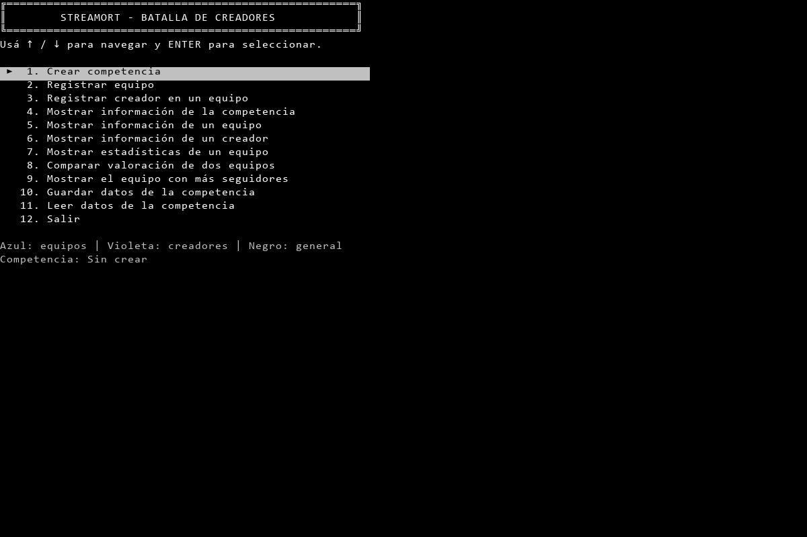
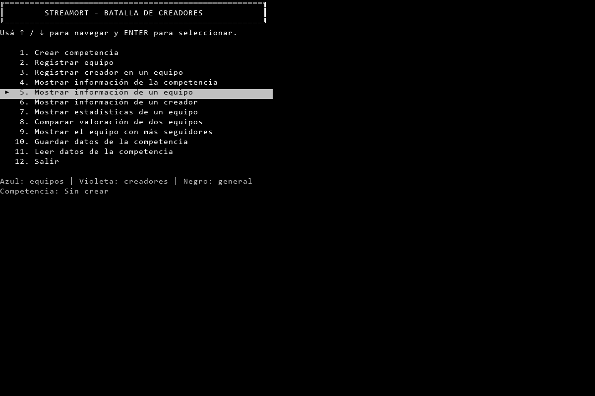

# Menú con presentación y navegación compatibles

Fecha: 03/11/2026. Etapa 3.5, adaptación de `PedirOpcionMenu`. Se modificó una unidad de código por vez y se publicó antes de continuar.

## Cambios de Mis-Librerias

| Commit publicado | Unidad | Motivo |
| --- | --- | --- |
| `f88a17b` | Nuevo struct `FormatoMenu` | Agrupar opciones de presentación y navegación, sin agregarlas a ColoresMenu ni multiplicar los argumentos. |
| `3c5ddcf` | Nueva sobrecarga de PedirOpcionMenu | Incorporar pantalla de flechas configurable y listas numéricas con validación, preservando las firmas previas y el menú múltiple. Incluye documentación de la firma. |
| `f4af93aea37cbff6cd73061136edd7a81abb209a` | Guía de Utilidades | Quitar un encabezado vacío que había quedado entre las secciones nuevas. |

Todos están disponibles en `main` de https://github.com/51215927-spec/Mis-Librerias.git. El principal registra ese último commit en el submódulo, después de publicarse las bibliotecas.

La firma es:

```csharp
int PedirOpcionMenu(string[] menu, string mensaje, ColoresMenu colores, FormatoMenu formato)
```

`FormatoMenu` contiene ocho propiedades: SeleccionInicial, Ancho, Marcador, Ayuda, Pie, NumerarOpciones, NavegacionCircular y SeleccionNumerica. El diseño y sus valores predeterminados se documentaron en `IA/Arquitectura.md` antes de implementar. El llamador proporciona el título y el contexto; no hay referencias a clases del dominio en la biblioteca.

En modo de flechas, el menú ocupa una pantalla nueva, descarta el historial anterior y no registra sus propios cuadros. Los colores y el estado de guardado se restauran al terminar. La opción inicial se recibe del llamador; el resultado sigue siendo un índice desde cero. La selección de categoría y especialidad usa el mismo método con SeleccionNumerica=true, agregando lista y solicitud al formulario sin borrar los datos ya ingresados. Sin consola interactiva se usa esa entrada numérica.

## Integración en Main

Único método de la aplicación modificado: `Program.Main`. Configura la paleta Black/Gray, opciones White, pie Gray, ancho 55, marcador y ayuda del original; elimina la numeración de las etiquetas porque la genera la biblioteca; conserva el índice y proporciona leyenda y nombre de competencia. Limpia pantalla/historial al entrar a una operación. La salida se fija en UTF-8 para que las flechas y el marcador se transmitan correctamente.

La primera comprobación de la aplicación encontró 90 celdas diferentes: la sonda configuraba UTF-8, pero Main no lo hacía y perdía los caracteres a partir de las flechas y del marcador. Se corrigió dentro del mismo cambio de Main antes de publicarlo; la repetición pasó en los tres tamaños. No se modificó la biblioteca para ocultar esa diferencia.

Los casos del switch siguen sin conectar altas, consultas o persistencia. El TOP 3 no se implementa en esta tarea y la lectura sin competencia todavía requiere la corrección prevista en la etapa 4. Las pantallas de operación incompletas no se presentan como equivalentes al original; el contraste de aplicación cubre el menú principal y el regreso.

## Comprobaciones

Las capturas previas del original se usaron como referencia. Se compararon las celdas de pantalla y sus colores lógicos; únicamente se normalizó `default` de ANSI a Gray/Black y se ignoró el color de texto de los espacios, conservando sus fondos. No es una comparación aproximada de las frases.

| Caso | Resultado |
| --- | --- |
| Menú inicial de sonda y aplicación a 120×40, 80×24 y 160×40 | Mismas celdas visibles y colores que el original en cada tamaño. |
| Arriba desde primera, abajo desde última | Circularidad y pantallas coinciden con las capturas originales. |
| Quinta opción y regreso | Se conserva la selección; no se acumulan título, menú o mensajes anteriores. |
| Home/End/PageUp/PageDown/número 5/Escape | No cambian la selección en el nuevo formato, conforme al ensayo previo. |
| Categoría: 0, 5, x y Enter vacío; especialidad: 0 y x | Nueva investigación del original confirma «Ingresá un número entero válido.» y repregunta sin repetir toda la lista. La sección correspondiente de la sonda coincide con el original. |
| Modo numérico | Conserva los datos previos y devuelve 0 al elegir 1; mantiene el registro activo. |
| Lista de 80 opciones a 80×24 | Al subir desde la primera se mantiene visible y se devuelve la última, índice 79. |
| Navegación sin ciclo | Arriba desde primera permanece en índice 0. |
| Etiquetas sin numeración automática | Se muestran y se seleccionan sin agregar números. |
| Registro desactivado por el llamador | Permanece desactivado al terminar. |
| Lista null/vacía, ancho negativo e índice inicial negativo/fuera de rango | Cinco rechazos con excepciones adecuadas sin alterar colores o estado de registro. |
| Entrada redirigida | Lista numérica y repreguntas; devuelve el índice correcto. |
| Fin de entrada | EndOfStreamException, sin bucle infinito. |

Las capturas de inicio y regreso de la aplicación y el resultado confirmado de las sondas se inspeccionaron visualmente. La evidencia reúne 36 PNG, 36 TXT, entradas y segmentos por celda, más [resultado-sonda.json](../../test/resultados/MenuCompatible-20261103/resultado-sonda.json), [resultado-aplicacion.json](../../test/resultados/MenuCompatible-20261103/resultado-aplicacion.json) e integridad de los archivos originales. Los `.ansi.txt` permanecen locales por la regla existente. [Carpeta de evidencia](../../test/resultados/MenuCompatible-20261103).





Los PNG son reconstrucciones ANSI con la misma fuente y paleta explícitas de la investigación previa, no fotografías de la ventana física. El resultado no afirma equivalencia universal en toda terminal, tamaño, cambio de dimensiones o texto Unicode de ancho especial.

## Compilación y repetición

SDK 10.0.401; destino net8.0 sin cambios. Compilaciones de aplicación y sonda correctas: advertencias previas CA1416 en Utilidades y CS0219 en Program, sin errores. Sesiones sobre runtime .NET 8.0.33 local. Artefactos aislados; NuGetAudit=false desactiva solo la auditoría en estas compilaciones.

```powershell
dotnet build "ACTIVIDAD ESPECIAL.sln" --artifacts-path IA/Verificacion/MenuCompatible/CompilacionAplicacion -p:NuGetAudit=false
dotnet build IA/Investigacion/SondaMenuCompatible/SondaMenuCompatible.csproj --artifacts-path IA/Verificacion/MenuCompatible/CompilacionSonda -p:NuGetAudit=false
python IA/Investigacion/verificar_menu_compatible.py --original
python IA/Investigacion/verificar_menu_compatible.py --sonda
python IA/Investigacion/verificar_menu_compatible.py --aplicacion
```

La sesión `--original` utiliza una copia nueva de Ejecutable bajo `IA/Verificacion/MenuCompatible/Original` y se niega a sobrescribirla. Para repetirla, conservar esa carpeta con otro nombre antes de ejecutar; no borrar los datos originales. Los hashes antes/después coinciden. Las otras sesiones regeneran su evidencia y requieren las herramientas locales de las tareas anteriores. Las sondas son auxiliares de investigación fuera de la solución académica y no sustituyen las pruebas unitarias finales.

Siguiente tarea: adaptar `MostrarTabla` y las demás funciones de presentación. La revisión final de toda la documentación de Mis-Librerias sigue pendiente como última tarea de la etapa.
