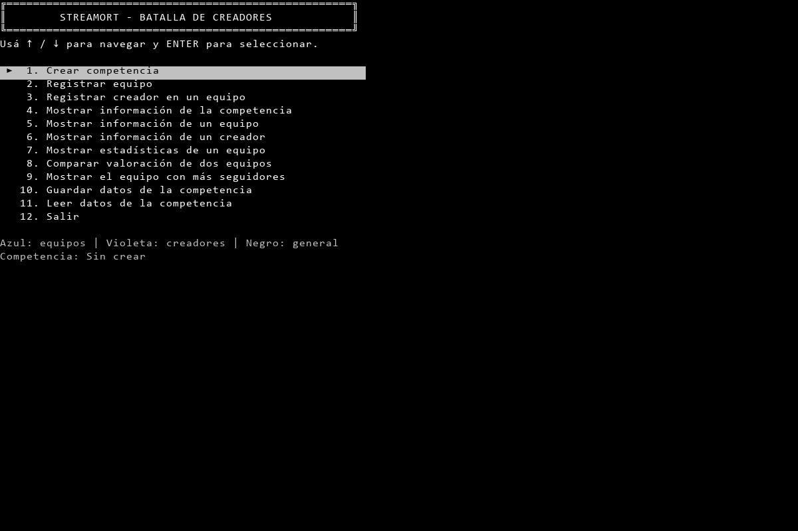

# Verificación de compilación y consola de la etapa 3.5

Fecha: 03/11/2026. Pedido: «siguente paso». Se sigue el plan local vigente: la tarea de adaptar MostrarTabla estaba eliminada antes de iniciar esta consulta. Se preserva esa edición, sin modificar bibliotecas ni ejecutar la tarea retirada.

## Compilación actual

Código principal en `3098a38`; submódulo `Mis Librerias` en `f4af93aea37cbff6cd73061136edd7a81abb209a`, limpio y coincidente con `origin/main` tras fetch. Cuenta `51215927-spec` comprobada con gh, permiso ADMIN en ambos repositorios.

| Componente | Resultado |
| --- | --- |
| Mis Librerias.slnx | Cero errores; advertencia previa CA1416. |
| ACTIVIDAD ESPECIAL.sln | Cero errores; advertencias previas CA1416 y CS0219. |
| SondaMenuCompatible.csproj | Cero errores; advertencia previa CA1416. |

SDK 10.0.401, destino net8.0 sin cambios. Sesiones ejecutadas con .NET 8.0.33 local. Artefactos aislados en `IA/Verificacion/VerificacionEtapa35`; NuGetAudit=false desactiva únicamente la auditoría de NuGet para estos comandos. No se modificaron bin/obj versionados ni archivos del ejecutable original.

## Contraste repetido

Se utilizó la compilación nueva, conservando los scripts y las capturas originales de referencia de los pasos anteriores. `verificar_etapa35.py` cambia los destinos de trabajo y evidencia para no sobrescribirlos.

- Menú principal de aplicación y sonda: texto, posiciones y colores lógicos coinciden con el original a 80×24, 120×40 y 160×40.
- En 120×40: navegación circular en ambos extremos, quinta selección conservada al volver y ausencia de residuos de la pantalla anterior.
- Home, End, PageUp, PageDown, número 5 y Escape no alteran la selección en el formato nuevo, según el contraste previo.
- Listas numéricas de categoría y especialidad: lista, solicitud y repreguntas coinciden con el original; preservan los datos anteriores del formulario. Se rechazaron valores fuera de rango, letras y entrada vacía en los escenarios registrados.
- Lista de 80 opciones: la última permanece visible y devuelve índice 79. También pasan configuración sin ciclo, sin números y registro inicialmente desactivado.
- Cinco configuraciones inválidas se rechazan sin alterar colores/registro. Entrada redirigida repregunta y devuelve índice correcto; EOF termina con EndOfStreamException sin bucle infinito.

Evidencia: 28 PNG y 28 TXT nuevos, JSON de entradas/segmentos y [resultado.json](../../test/resultados/VerificacionEtapa35-20261103/resultado.json). `original-numerico.json` de esta carpeta es una copia de la referencia de la investigación anterior, no una sesión nueva. No se volvió a ejecutar el original ni se manipularon sus datos. Se inspeccionaron visualmente el menú actualizado y la lista de categoría tras entrada vacía.

Las imágenes reconstruyen celdas ANSI con la fuente y paleta explícitas documentadas previamente. La comparación normaliza colores predeterminados a Gray/Black e ignora solo el color de texto de espacios; no ignora sus fondos. No certifica identidad física en toda terminal o equivalencia ante cualquier tamaño, redimensionamiento o carácter Unicode de ancho especial.



## Límite del cierre

Se completa la verificación de lo implementado en esta etapa: bibliotecas compilables, menú principal y selección numérica. Los casos del switch, las altas y fichas todavía provisionales, la lectura sin competencia, el TOP 3 de salida y la persistencia se verificarán cuando se conecten en las etapas correspondientes. No se declara equivalencia de pantallas inexistentes.

MostrarTabla conserva su comportamiento actual con bordes; no se modifica ni se da por adaptado al formato del original. La edición local que retiró esa tarea se conserva fuera del commit de esta verificación. La etapa 3.5 sigue abierta por las tareas restantes de publicación, distribución y documentación.

## Repetir

```powershell
dotnet build "Mis Librerias/Mis Librerias.slnx" --artifacts-path IA/Verificacion/VerificacionEtapa35/CompilacionBibliotecas -p:NuGetAudit=false
dotnet build "ACTIVIDAD ESPECIAL.sln" --artifacts-path IA/Verificacion/VerificacionEtapa35/CompilacionAplicacion -p:NuGetAudit=false
dotnet build IA/Investigacion/SondaMenuCompatible/SondaMenuCompatible.csproj --artifacts-path IA/Verificacion/VerificacionEtapa35/CompilacionSonda -p:NuGetAudit=false
python IA/Investigacion/verificar_etapa35.py
```

Requiere las herramientas auxiliares locales de la investigación anterior. No se agregan paquetes a la aplicación ni proyectos a la solución académica. Las capturas crudas ANSI siguen excluidas por la regla existente.
